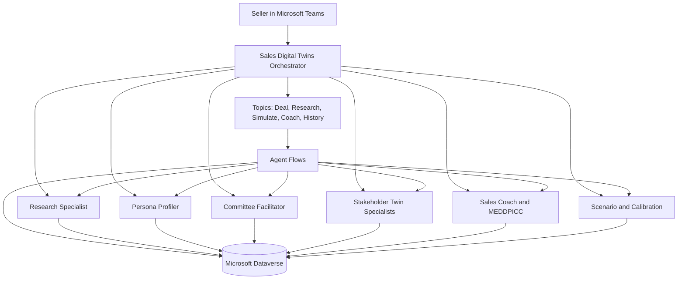

# Solution Architecture — Native Copilot Studio

## 1. Architecture decision

**Selected:** native Power Platform implementation.

- Copilot Studio standard harness: primary conversational experience, topics, prompt tools and connected agents.
- Copilot Studio agent flows: deterministic workflow coordination, multi-round loop, approvals, persistence and status handling.
- Dataverse: system of record for accounts, deals, stakeholders, facts, twins, simulations, turns, scenarios, assessments and calibration.
- Microsoft Teams: primary user channel with Microsoft Entra ID authentication.

No LangGraph runtime, FastAPI, Azure Functions, Azure AI Foundry dependency, external vector database, or custom API is part of the MVP. The original Python implementation is a behavioral reference and test oracle during migration.

## 2. Logical architecture

## 3. Agent topology

### Primary agent
**Sales Digital Twins Orchestrator** owns user interaction, validates intent and context, invokes topics/tools, and summarizes persisted results.

### Connected specialist agents
1. **Research Specialist** — summarizes public professional facts and source references; results require user approval.
2. **Persona Profiler** — maps approved facts or archetypes into a structured twin profile.
3. **Committee Facilitator** — evaluates round transcript and returns strict decision JSON.
4. **Stakeholder Twin** — role-configured specialist behavior. Prefer one connected agent per role where the platform configuration and capacity permit; otherwise use a single role-conditioned prompt tool with role as a required input.
5. **Sales Coach & MEDDPICC** — assesses actual seller pitch and evidence for the eight MEDDPICC dimensions.
6. **Scenario & Calibration Analyst** — compares scenario verdicts and matches predicted objections to actual transcript evidence.

Do not create separate autonomous agents for every minor operation. Keep deterministic CRUD, validation and iteration in agent flows.

## 4. Simulation orchestration

The agent flow is the control plane. It maintains explicit state in Dataverse and executes bounded rounds:

1. Load simulation and selected twin profiles.
2. Set round number to 1 and initialize status = Running.
3. Determine speaking order. Round 1 uses configured order; after escalation, prioritize unresolved blockers by decision power.
4. For each speaker, call the role-conditioned Stakeholder Twin prompt with deal context, profile and transcript-so-far.
5. Validate structured output and persist a Debate Turn.
6. After all speakers, call Facilitator.
7. If decision = continue or escalate and round < MaxRounds, start next round.
8. Otherwise call synthesis/assessment and set simulation status = Completed.
9. If any required step fails, set status = Failed or NeedsReview, record error and do not fabricate a verdict.

Defaults: MaxRounds = 3; committee size 4–6; one turn per selected stakeholder per round. Limit the total turn count using a configurable ceiling. Avoid unbounded agent-flow loops.

## 5. Native orchestration constraints

- Use generative orchestration for routing user requests to relevant topics and tools.
- Use explicit topics for confirmation, approval, and user-visible state transitions.
- Use agent flows for deterministic loops, Dataverse writes, and multi-step operations.
- Connected agents return summaries/structured outputs; they do not own the parent workflow state.
- Do not assume an LLM returns valid JSON. Validate required keys, enums, numeric bounds and string lengths before persistence.
- If a prompt tool cannot enforce a schema in the selected authoring surface, parse and validate its response in the flow and route malformed output to a bounded retry/error path.
- Agent flow run duration and platform quotas must be validated in the target tenant. For longer workloads, split execution into resumable flow stages rather than holding a Teams turn open.
- Dataverse for Teams is not the target. Use a full Dataverse environment.

## 6. Dataverse access pattern

Use Dataverse connector actions in agent flows for create, read, update and list operations. Use alternate keys for idempotent business identifiers where suitable. Enforce owner/team scope and least privilege. The agent must never rely on a conversation variable as the only copy of a durable simulation state.

## 7. Security boundaries

- Authenticate users through Teams / Entra ID.
- Use Dataverse security roles and business units/teams as required by tenant structure.
- Configure Power Platform DLP to permit only approved connectors.
- Use agent author credentials only for shared service operations with explicit approval; otherwise use user-context connections where supported.
- Research outputs and user-uploaded transcripts are untrusted data, not agent instructions.
- Never place secrets in prompts, topics, environment variables visible to end users, or conversation variables.
- Apply retention, deletion and data-subject request processes to transcripts and stakeholder facts.

## 8. Observability

Persist:
- Simulation ID, correlation ID, user/owner, created time and status.
- Round number, speaker role, turn order and prompt version.
- Facilitator decision and rationale.
- Model/tool errors and retry count.
- Completion time and turn count.
- Approval decisions and source URLs.

Monitor Copilot Studio analytics and Power Platform flow run history. Define operational alerts and support ownership before production.

## 9. ALM

Use a Power Platform solution with publisher prefix `dt`. Keep development, test and production environments separate. Use environment variables only for non-secret configuration. Use connection references for connectors. Export managed solution for production and document Teams publication approval.
